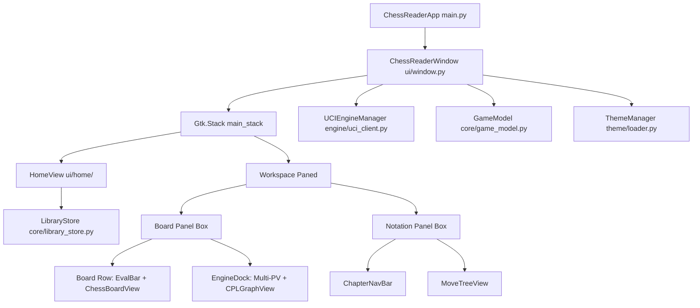

# Comprehensive ChessBase Benchmark & Architectural Gap Analysis
**Project:** ChessReader (Linux-Native Chess PGN Viewer, Editor & Study Suite)  
**Target Benchmark:** ChessBase (v17 / v18 Industry Standard)  
**Design Ethos:** Zed Editor Minimalist Dark Aesthetic (GTK4 / Libadwaita / Cairo)  
**Document Version:** 1.0.0 — Production Roadmap & Architectural Blueprint  
**Date:** October 2026  

---

## 1. Executive Summary

### 1.1 The Vision: The "Zed of Chess"
**ChessReader** is conceived as a high-performance, distraction-free, Linux-native chess workstation. It aims to bridge the long-standing void in the Linux chess ecosystem: the absence of a software suite that combines the industrial database, analytical, and notation power of **ChessBase** with the aesthetic purity, responsive ergonomics, and lightweight footprint of modern code editors like **Zed**.

For over three decades, ChessBase has remained the unchallenged titan of competitive chess preparation, master-level research, and database curation. However, ChessBase suffers from legacy technical debt: it is tied exclusively to Windows, relies on an archaic Microsoft Office-style ribbon UI littered with nested modal dialogs, consumes significant system memory, and lacks first-class Linux/Wayland support (forcing Linux users to wrestle with sluggish Wine wrappers or fragmented open-source alternatives like Scid vs. PC).

ChessReader leverages a modern Linux stack—**Python 3.11+, PyGObject (GTK4 + Libadwaita), Cairo/GSK vector rendering, and `python-chess`**—delivering instant startup, native Wayland fractional scaling, 120+ FPS hardware-accelerated board interactions, and keyboard-first navigation via a command palette (`Ctrl+K`/`Ctrl+P`).

```
┌────────────────────────────────────────────────────────────────────────┐
│ ChessReader Vision: Industrial Chess Power × Zed Minimalist Ergonomics │
├──────────────────────────────────┬─────────────────────────────────────┤
│ ChessBase Legacy (Windows)       │ ChessReader Target (Linux/Wayland)  │
├──────────────────────────────────┼─────────────────────────────────────┤
│ • Bloated Ribbon Interface       │ • 1px Subtle Zinc Dividers (#27272a)│
│ • Modal Dialog Overload          │ • Non-Modal Command Palette (⌘K)    │
│ • Proprietary Binary Formats     │ • Open PGN Standards + SQLite Cache │
│ • High Memory Footprint          │ • Instant Startup & Lightweight VRAM│
│ • Windows Exclusive (Wine bugs)  │ • Native Wayland / CSD / Dark Mode  │
└──────────────────────────────────┴─────────────────────────────────────┘
```

### 1.2 Current Maturity Assessment
A rigorous audit of the existing codebase indicates that ChessReader is currently in an **advanced functional prototype / alpha phase**:
* **Foundational Strengths:** Cairo-based vector board rendering with piece dragging, asynchronous non-blocking Stockfish UCI engine integration, recursive variation tree management (RAVs) with line promotion/deletion, theme/piece customization, and basic multi-game PGN loading are fully operational and verified by 59 automated unit tests.
* **Core Vulnerabilities:** The layout is currently **unstructured and rigid**. The application relies on a single inflexible split pane, an engine dock that crowds out the chessboard, a jarring full-screen flip between the "Home Library" and "Board Analysis" views, absent in-board player metadata, a lack of pawn underpromotion handling, and synchronous PGN parsing that freezes on tournament-scale databases (100k+ games). Furthermore, critical competitive tools—such as an Opening Explorer reference tree, positional board searches, and comprehensive PGN header editors—are completely missing.

---

## 2. Current Implementation Status

A detailed technical inventory of the codebase across its primary modules:



### 2.1 Working / Verified Components
1. **Interactive Chessboard (`chess_reader/ui/board/board_view.py`):**
   - Hardware-accelerated Cairo rendering pipeline with sub-pixel rendering.
   - Smooth left-click piece dragging and click-to-move square selection with legal move dots and capture rings.
   - Right-click vector arrow drawing (`draw_cairo_arrow`) and square highlights.
   - Dynamic board flipping (`F`) with coordinate adjustment.
   - Board coordinate margins rendered on border frames (ChessBase style) or within squares.
   - Full support for solid square colors, dual-tile PNG textures, and full-board backdrop images (`yellow.png`).
2. **Move Tree & Recursive Variations (`chess_reader/core/game_model.py`, `ui/notation/move_tree_view.py`):**
   - AST management using `python-chess`: supports nested RAVs (Recursive Annotation Variations).
   - Dynamic branch promotion (`promote_variation`) swapping sub-variations to the mainline.
   - Sub-variation pruning (`delete_variation`) with parent retreat.
   - Inline NAG badges rendering 22 standard symbols (`!`, `?`, `‼`, `⁇`, `⩲`, `±`, etc.).
   - Comment metadata parsing and serialization for `[%clk hh:mm:ss]` and `[%eval ...]`.
   - Monospace tree indentation visually matching code editors.
3. **UCI Engine Client & Analysis Dock (`chess_reader/engine/`, `ui/dock/`):**
   - Non-blocking asynchronous Stockfish management over Linux pipes in a background thread.
   - Live Multi-PV candidate lines streaming without GUI freezing (`GLib.idle_add`).
   - Dynamic vertical advantage evaluation bar (`EvalBar`) with win percentage curve and explicit `+`/`-` score formatting below the bar.
   - Batch automated game review (`BatchGameReviewer`) calculating average centipawn loss (CPL), estimated accuracy percentages, and move classifications (`Brilliant`, `Best`, `Good`, `Inaccuracy`, `Mistake`, `Blunder`).
   - Vector CPL trajectory momentum graph (`CPLGraphView`) with interactive ply-clicking.
   - Engine discovery and registration subsystem (`EngineRegistry`, `EngineDialog`).
4. **Theme & Asset Cache (`chess_reader/theme/`):**
   - Pydantic-validated theme schema (`schema.py`) parsing YAML definitions (`zed-dark.yaml`, `classic-wood.yaml`, `neo-yellow.yaml`).
   - Cairo image surface cache (`PieceAssetCache`) scaling piece PNG/SVGs on demand with DPI-aware scale factor support.
   - Multi-piece set manager (`piece_sets.py`) with support for user piece set folder imports.
5. **Command Palette (`chess_reader/ui/palette/command_palette.py`):**
   - Floating modal launcher (`Ctrl+K` / `Ctrl+P`) featuring fuzzy matching across actions, themes, and navigation commands.

---

### 2.2 Partially Implemented / WIP Modules
1. **Chapter & Multi-Game Navigation (`ChapterNavBar`):**
   - Functional prev/next buttons and game list popover, but parsing games from multi-game PGNs is done synchronously.
   - Game titles in popover lack tournament metadata (Elo ratings, round numbers, time controls).
2. **Library Store & Home Browser (`LibraryStore`, `HomeView`):**
   - Pinned folder shortcuts and recent database tracking stored in `~/.config/chess-reader/library.json`.
   - File listing counts games by estimating `[Event ` headers.
   - Game filtering is simple substring search on in-memory lists; no indexing structure exists for large databases.
3. **Position Setup (`FENSetupDialog`):**
   - Validates FEN strings and loads positions, but lacks a graphical piece palette for drag-and-drop piece placement.

---

### 2.3 Broken, Missing, or Structurally Flawed Elements
1. **Pawn Promotion Defaults to Queen (CRITICAL UX BUG):**
   - In `board_view.py:276`, pawn promotions automatically default to `chess.QUEEN`. There is no visual promotion picker dialog, making tactical underpromotions (e.g., underpromoting to Knight with check) impossible via the board interface.
2. **Missing Multi-Color Annotation Modifiers:**
   - Right-click drawing only produces green arrows and red highlights. Standard chess software modifiers (`Shift+RightClick` for green/yellow, `Alt+RightClick` for blue, `Ctrl+RightClick` for red) are absent.
3. **Rigid, Unstructured Workspace Layout:**
   - The workspace layout is hardcoded into a single `Gtk.Paned` with the board and engine dock stacked vertically in the left panel. As a result, expanding the engine dock squeezes the chessboard vertically, triggering aggressive letterboxing.
   - No dedicated container exists for player cards (names, titles, Elo ratings, active clocks, captured piece counters).
4. **Disjointed View Switching:**
   - Switching between "Databases" and "Board Analysis" completely swaps the main window stack (`Gtk.Stack`), severing the player's context. In ChessBase, the database list and the live board operate either as docked adjacent panes or synchronized MDI windows.
5. **No PGN Header & Metadata Editor:**
   - Users cannot edit player names, dates, events, rounds, or FIDE tags from the GUI.
6. **No Positional Search or Opening Reference Explorer:**
   - The application has no mechanism to search databases by board position, pawn structure, or material distribution, nor does it provide an opening move statistical tree.

---

## 3. Comprehensive Dimensional Benchmark vs. ChessBase

The table below measures our current implementation against the industry benchmark across the five core pillars.

### Evaluation Criteria:
* **Critical:** Fundamental omission that blocks everyday competitive use or violates core chess UX expectations.
* **Moderate:** Major functionality gap that limits the tool's utility for advanced study or tournament preparation.
* **Nice-to-have:** Polish, advanced luxury workflow, or secondary enhancement.

| Pillar & Feature | ChessBase Standard (v17/v18) | ChessReader (Current State) | Gap Severity | Complexity |
| :--- | :--- | :--- | :--- | :--- |
| **1. BOARD EXPERIENCE & UI/UX** | | | | |
| Layout Modularity & Docking | Fully customizable multi-pane docking system; undockable floating windows across multiple monitors. | Single horizontal split `Gtk.Paned` with hardcoded proportions; board squeezed vertically by bottom dock. | **Critical** | Medium |
| Distraction-Free / High Density | Cluttered Windows ribbon chrome; dense text tables; visually exhausting. | Minimalist Zed aesthetic; dark charcoal palette; clean 1px borders; no ribbon clutter. | *Advantage (Zed)* | Low |
| Piece Drag & Interaction | Micro-animations, sound effects, legal target highlighting, auto-promotion customizable. | 120 FPS Cairo dragging, capture rings, legal move dots; **auto-queens without promotion dialog**. | **Critical** | Low |
| Arrow & Highlight System | Multi-color vector arrows (Green, Red, Yellow, Blue) mapped to Alt/Ctrl/Shift keys; persistent PGN storage. | Single-color green arrows and red highlights; no keyboard modifier color switching; not serialized to PGN. | **Moderate** | Low |
| Player Info & Clocks | Rich player cards with FIDE titles, national flags, Elo rating differentials, live digital clocks. | Absent. Matchup only visible in window titlebar breadcrumbs. No clock display or capture difference counters. | **Critical** | Medium |
| Board Right-Click Context Menu | Context menu for position copy, FEN export, diagram insertion, flip, engine trigger. | No board context menu; right-click is exclusively captured by drawing gesture. | **Moderate** | Low |
| **2. NOTATION & ANNOTATION ENGINE** | | | | |
| Tree Navigation & RAV Branching | Deep recursive variation trees; inline and tabular notation modes; fold/unfold sub-variations. | Recursive RAV tree with code-editor indentation; branch promotion and deletion buttons. | **Moderate** | Medium |
| Rich Text Annotations | Commentary before and after moves; paragraph inserts; colored text; training questions with answer masks. | Inline single-string comments and `[%clk]`/`[%eval]` pills. No pre-move comments or training dialogs. | **Moderate** | Medium |
| NAG (Glyph) Palette & Shortcuts | Full palette of 100+ standard FIDE/Informator NAGs; direct number key bindings (`1` for `!`, `2` for `?`, etc.). | 22 NAGs supported in core model; no direct keyboard shortcut bindings; no visual glyph palette. | **Moderate** | Low |
| PGN Header & Tag Editing | Comprehensive dialog to edit all Seven Tag Roster (STR) and custom FIDE/USCF metadata tags. | **None**. Headers are read-only; editing headers requires opening the `.pgn` file in an external text editor. | **Critical** | Low |
| Graphical Board Diagrams in PGN | Embeds `[#]` diagram markers that render inline visual chess diagrams in printed and exported text. | None. Board drawings exist only in memory during the active session. | **Nice-to-have** | Medium |
| **3. DATABASE & ARCHIVE MANAGEMENT** | | | | |
| Database Formats & Scale | Proprietary `.cbh` / `.2cbh` binary formats; instant indexing and search over 15+ million games (Mega Database). | Plaintext `.pgn` files parsed with `python-chess`. Synchronous header reading chokes on files > 10 MB. | **Critical** | High |
| Database Tabular Grid | High-density sortable virtualized table (Number, White, Black, Result, ECO, Date, Event, Rounds, Moves). | Simple vertical card list in `HomeView`; lacks columnar sorting, column resizing, and pagination. | **Critical** | Medium |
| Batch Operations | Game merging, duplicate detection, ECO classification, tournament cross-table generation, batch PGN export. | Single game loading and single game PGN export to clipboard. No batch operations. | **Moderate** | High |
| Workspace Context | Database browser and board analysis stay active concurrently side-by-side or in separate windows. | Disjointed full-stack toggle (`Gtk.Stack`) replaces the board with the library view. | **Critical** | Low |
| **4. ENGINE & ANALYTICAL CAPABILITIES** | | | | |
| UCI Pipeline & Multi-PV | Multi-PV lines (1-20), configurable threads, hash size (MB), Syzygy endgame path, custom UCI options. | Asynchronous pipe to Stockfish, fixed 3-PV lines, fixed depth 20/24; **no Hash/Threads tuning UI**. | **Moderate** | Medium |
| Multi-Engine Concurrency | Run 2 to 4 engines concurrently (e.g. Stockfish NNUE + Leela Chess Zero side-by-side). | Single active engine instance. | **Nice-to-have** | High |
| Automated Tactical Game Review | Automatic blunder detection, human-readable commentary, centipawn loss graphs, accuracy scores. | Batch review module with CPL curve graph, accuracy % calculation, and move classifications. | **Moderate** | Medium |
| Endgame Tablebases | Direct Nalimov / Syzygy 6-man and 7-man tablebase probing with instant DTM/WDW evaluation. | **None**. Endgames rely solely on brute-force engine search. | **Moderate** | Medium |
| Cloud Engine & Let's Check | Shared global hash evaluation repository ("Let's Check"); instant GM-depth evaluations from the cloud. | None. All analysis is computed locally. | **Nice-to-have** | High |
| **5. SEARCH & REFERENCE TOOLS** | | | | |
| Positional Board Search | Search multi-million game archives for identical FEN, pawn structure, or material imbalances. | **None**. Only basic plaintext string search on player/event names. | **Critical** | High |
| Opening Explorer / Reference Tree | Real-time statistics tree showing move win-rates (%), total games, average rating, and performance. | **None**. No opening statistics tree exists. | **Critical** | High |
| Player Dossier & Repertoire Prep | Automated generation of player opening dossiers, win-rate by white/black, and tactical weaknesses. | None. | **Nice-to-have** | High |

---

## 4. Pros & Cons Breakdown

### 4.1 Current Strengths (Our Competitive Edge)
1. **Linux-Native Performance & Modern Wayland Architecture:**
   - Unlike ChessBase (which requires Windows or error-prone Wine layers with broken font antialiasing and scaling artifacts), ChessReader is built natively for Linux on GTK4, Libadwaita, and Wayland. It supports true fractional scaling, native Client-Side Decorations (CSD), and dark system themes out of the box.
2. **Zed-Inspired Minimalist Ergonomics:**
   - Complete absence of visual bloat. Replaces the chaotic, dated Microsoft Office-style ribbon menus of ChessBase with a focused, high-density zinc palette (`#121316`, `#18181b`), subtle 1px structural dividers (`#27272a`), and clean JetBrains Mono typography.
3. **Buttery 120+ FPS Hardware-Accelerated Rendering:**
   - Board interactions, vector arrows, and piece dragging are rendered directly via Cairo vector primitives, avoiding DOM or heavy web-tech overhead (such as Electron).
4. **Command Palette Integration (`Ctrl+K` / `Ctrl+P`):**
   - Modern developer-centric keyboard workflow. Users can change themes, switch piece sets, reset the board, manage engines, copy FENs, and trigger game reviews without reaching for the mouse.
5. **Open Standard & Modular Theme Engine:**
   - Clean separation of assets and configuration. YAML-based theme definitions and transparent PNG/SVG piece mappings allow users to create and import custom boards and piece sets with zero compiled binary locks.

### 4.2 Current Deficiencies (Where We Fall Short)
1. **Unstructured & Cramped Board Layout:**
   - The interactive board, eval bar, and engine dock are crammed into one vertical column. Because chessboards must maintain a 1:1 square aspect ratio, expanding the engine dock or resizing the window horizontally results in awkward empty spaces and severe board shrinkage.
2. **Missing Everyday Tactical Essentials:**
   - No pawn promotion dialog (auto-queening breaks underpromotion tactics).
   - Only single-color arrows with no Shift/Ctrl/Alt modifiers.
   - Missing player identity header cards with clocks, Elo ratings, and captured pieces.
3. **Severe Scalability Bottlenecks (Lack of Database Indexing):**
   - Reading PGN files directly via `chess.pgn.read_headers()` in Python is strictly linear ($O(N)$). Opening a 200 MB archive with 500,000 games will cause an application freeze. ChessBase uses binary indexed header caches that load millions of games in under 100 milliseconds.
4. **No Board Position or Opening Reference Tools:**
   - A chess database tool without an Opening Explorer or Positional Search cannot serve serious tournament players or coaches. Currently, the user cannot see which moves are historically most popular from the active position.
5. **Rigid Two-State View Architecture:**
   - Toggling between the database screen and the board screen via a full stack switcher destroys workflow continuity. Serious study requires keeping the game list visible alongside the live board.

---

## 5. UI/UX Refactoring Blueprint

To solve our unstructured UI while strictly honoring the Zed aesthetic, we propose an architectural redesign of the main workspace.

### 5.1 The 3-Column / Modular Tiled Layout

Instead of a binary toggle between Home and Board views, ChessReader should feature a **unified 3-column workspace** with collapsible sidebars:

```
┌───────────────────────────────────────────────────────────────────────────────────────────────────────────┐
│ [CSD HeaderBar] 🗄 Databases  ♟ Board Analysis   Grand Prix 2026 / Round 4 / Carlsen vs Caruana    ⚙ ♟ ⌘K ✕ │
├──────────────────────────┬─────────────────────────────────────────────────┬──────────────────────────────┤
│ LEFT DRAWER (Collapsible)│ CENTER CANVAS: Board & Evaluation               │ RIGHT PANEL: Study & Engine  │
│ (Width: 320px)           │ (Adaptive square scaling)                       │ (Width: 420px)               │
├──────────────────────────┼─────────────────────────────────────────────────┼──────────────────────────────┤
│ 📁 PINNED SHORTCUTS      │ ┌─────────────────────────────────────────────┐ │ ┌─ TABS: Moves | Reference ┐ │
│  ▸ Master Games (45k)    │ │ [Black Player Card] ♚ Caruana (2805)  14:32 │ │ │ 1. e4   e5   2. Nf3  Nc6   │ │
│  ▸ 2026 Repertoire       │ ├─────────────────────────────────────────────┤ │ │ 3. Bb5  a6 (3...Nf6 Berlin)│ │
│  ▸ Blitz Archives        │ │ [E]                                         │ │ │ 4. Ba4  Nf6   5. O-O  Be7    │ │
│                          │ │ [v]                                         │ │ │ 6. Re1  b5   7. Bb3  d6      │ │
│ 🗄 DATABASE GAMES        │ │ [a]        CHESSBOARD CANVAS                │ │ ├──────────────────────────┤ │
│  Filter: [ carlsen     ] │ │ [l]        (Maintains 1:1 Aspect)           │ │ │ [Rich Move Commentary]   │ │
│ ──────────────────────── │ │ [B]                                         │ │ │ "A well-known mainline   │ │
│ #  White   Black  Res ECO│ │ [a]                                         │ │ │  Spanish setup..."       │ │
│ 1  Carlsen Naka   1-0 C84│ │ [r]                                         │ │ ├──────────────────────────┤ │
│ 2  Caruana Giri   ½-½ B90│ ├─────────────────────────────────────────────┤ │ ⚙ ENGINE CONSOLE (Collaps) │ │
│ 3  Firouzja Pragg 0-1 E04│ │ [White Player Card] ♔ Carlsen (2882)  18:45 │ │  Stockfish 18 · D28 · 4.2M │ │
│ 4  Gukesh  Ding   1-0 D38│ └─────────────────────────────────────────────┘ │  #1: +0.64  8. c3 O-O 9. h3 │ │
│                          │ ◀ Prev Game (Alt+[)     Next Game (Alt+]) ▶    │  #2: +0.28  8. a4 Rb8 9. axb│ │
│                          │                                                 │  [=== CPL Momentum Graph ==] │ │
├──────────────────────────┴─────────────────────────────────────────────────┴──────────────────────────────┤
│ [Status Bar] Stockfish 18: Ready · Depth 28 · FEN: r1bqk2r/1ppp1ppp/p1n5/4p3/B... · Theme: zed-dark · UTF-8 │
└───────────────────────────────────────────────────────────────────────────────────────────────────────────┘
```

### 5.2 Key Layout Specifications
1. **Left Drawer (Database & Archive Browser):**
   - Toggleable via `Ctrl+\` (matching Zed's project tree toggle) or top-left icon.
   - Pinned folder tree on top; virtualized games list table on bottom with column sorting (`No.`, `White`, `Black`, `Result`, `ECO`, `Year`).
   - Single-click previews headers; double-click instantly loads game onto the board canvas without full-screen navigation shifts.
2. **Center Canvas (Board Workspace):**
   - Board automatically scales to maximum available height while strictly locking the 1:1 aspect ratio.
   - **Player Cards:** Placed symmetrically above (opponent) and below (active user) the board:
     - Avatar / Piece icon, Grandmaster Title badge (`GM`, `IM`), Player Name, FIDE Elo rating.
     - Captured pieces differential display (`+2` with captured pawn/piece glyphs).
     - Digital countdown clock with active turn highlight border.
   - **Eval Bar:** Integrated flush against the left border of the chessboard rather than floating as an independent disconnected container.
3. **Right Panel (Unified Notation & Reference Studio):**
   - **Tab 1: Notation & Annotations:** Move tree rendered in clean monospace typography with nested RAV branches, inline NAG badges, commentary editor, and navigation bar.
   - **Tab 2: Opening Reference / Live Book:** Shows statistical breakdown of master moves from current position (% White wins, % Draws, % Black wins, Elo averages).
   - **Bottom Sub-Pane: Engine Console:** Displays Multi-PV lines, dynamic evaluation score, hash statistics, and the interactive Centipawn Loss graph. Can be collapsed with a single shortcut (`Ctrl+J`).

### 5.3 Zed Design Tokens & Typography

```css
/* Core Zed Palette Guidelines for GTK4 */
@define-color zed_bg_darkest      #121316; /* Titlebar, statusbar, toolbars */
@define-color zed_bg_base         #18181b; /* Center canvas backdrop */
@define-color zed_bg_panel        #1e1e24; /* Left & right sidebars */
@define-color zed_bg_hover        #27272a; /* Row hover highlight */
@define-color zed_bg_active       #323238; /* Active move selection token */

@define-color zed_border_subtle   #27272a; /* 1px panel dividers */
@define-color zed_border_focus    #3f3f46; /* Focused inputs, active borders */

@define-color zed_fg_primary      #f4f4f5; /* Primary move notation & titles */
@define-color zed_fg_secondary    #a1a1aa; /* Move numbers, metadata, tags */
@define-color zed_fg_muted        #71717a; /* Inactive icons, subtle labels */

@define-color zed_accent_blue     #61afef; /* Engine scores, links, highlights */
@define-color zed_accent_green    #98c379; /* Good moves (!), winning eval */
@define-color zed_accent_yellow   #e5c07b; /* Interesting moves (?!), warnings */
@define-color zed_accent_red      #e06c75; /* Blunders (??), checks, losses */

/* Monospace Font Configuration */
font-family: "JetBrains Mono", "Adwaita Mono", "Fira Code", monospace;
```

### 5.4 Unified Keyboard Shortcut Map

| Category | Shortcut | Action |
| :--- | :--- | :--- |
| **Workspace Navigation** | `Ctrl+\` | Toggle Left Database Drawer |
| | `Ctrl+J` | Toggle Bottom Engine Analysis Dock |
| | `Ctrl+K` or `Ctrl+P` | Open Zed Command Palette |
| | `Ctrl+B` | Focus Center Board Canvas |
| | `Ctrl+N` | Reset to Starting Position |
| | `Ctrl+O` | Open PGN File Chooser |
| | `Ctrl+S` | Save Active Game to PGN |
| **Game Move Traversal** | `Left Arrow` | Step One Move Backward |
| | `Right Arrow` | Step One Move Forward (Mainline) |
| | `Up Arrow` / `Down Arrow` | Switch Between Alternative Variations (RAVs) |
| | `Home` | Jump to Game Start |
| | `End` | Jump to Game End |
| | `Alt+Left` / `[` | Jump to Previous Game in PGN Archive |
| | `Alt+Right` / `]` | Jump to Next Game in PGN Archive |
| **Board Interaction** | `F` | Flip Board Orientation |
| | `Escape` | Clear All Arrows and Highlights |
| | `Space` | Toggle Live Engine Analysis (Run / Pause) |
| | `Ctrl+Shift+F` | Open FEN Position Setup Dialog |
| | `Ctrl+C` | Copy Active Board FEN to Clipboard |
| | `Ctrl+E` | Export Full PGN to Clipboard |
| **NAG Direct Keybindings** | `1` | Add `!` (Good Move) |
| | `2` | Add `?` (Poor Move / Mistake) |
| | `3` | Add `‼` (Brilliant Move) |
| | `4` | Add `⁇` (Blunder) |
| | `5` | Add `⁉` (Interesting Move) |
| | `6` | Add `⁈` (Dubious Move) |
| | `Ctrl+Alt+P` | Promote Current Variation to Mainline |
| | `Delete` | Delete Current Variation Branch |

---

## 6. Prioritized Feature Backlog

A phased roadmap designed to elevate ChessReader from an experimental prototype into a premier tournament-grade Linux chess suite.

### Tier 1: Core Essentials (Immediate Road to Daily Driver)
> *Prerequisites for everyday usage by club and tournament players.*

1. **Interactive Pawn Promotion Dialog (`board_view.py`):**
   - Replace auto-queening with an intuitive floating popover at the destination square displaying Queen, Knight, Rook, and Bishop glyphs.
2. **Multi-Color Board Annotations (`board_view.py`, `drawings.py`):**
   - Implement standard modifier keys:
     - `Right-Drag`: Green arrow (standard).
     - `Shift + Right-Drag`: Yellow/Amber arrow (alternative/caution).
     - `Ctrl + Right-Drag`: Red arrow (tactical/threat).
     - `Alt + Right-Drag`: Blue arrow (strategic/positional).
   - Serialize vector drawings to PGN comments using Lichess standard `[%draw ...]` / ChessBase format.
3. **Over/Under-Board Player Information Cards:**
   - Create clean, monospace status cards showing White/Black player names, FIDE titles, Elo ratings, material count differences, and clocks.
4. **PGN Header & Seven Tag Roster (STR) Editor Dialog:**
   - Add modal editor (`Ctrl+Shift+H`) to update `Event`, `Site`, `Date`, `Round`, `White`, `Black`, `Result`, `ECO`, `WhiteElo`, `BlackElo`, `TimeControl`, and `Annotator`.
5. **Direct Keyboard NAG Shortcuts:**
   - Bind numeric keys `1`-`6` to instantly append evaluation glyphs (`!`, `?`, `‼`, etc.) to the currently selected move node.
6. **Refactor Workspace into 3-Column Layout:**
   - Replace the rigid full-stack toggle with a collapsible left library drawer (`Ctrl+\`) and persistent right notation panel.

---

### Tier 2: Power Tools (Club & Tournament Competitor Grade)
> *Features that provide true competitive parity with desktop ChessBase.*

1. **High-Speed SQLite Database Caching:**
   - Implement an automated background indexing worker: when a `.pgn` database is opened or pinned, extract game headers and move paths into an optimized local SQLite cache (`~/.cache/chess-reader/index.db`).
   - Deliver instant sub-50ms sorting, filtering, and paging across 500,000+ games.
2. **Live Opening Explorer & Reference Tree:**
   - In-position reference tab showing master statistics:
     - Columnar breakdown: `Move`, `Games Count`, `Win % (White/Draw/Black)`, `Rating Performance`.
     - Data sourced either from local indexed PGNs or optional integration with the open Lichess Master Opening Database API.
3. **Full UCI Engine Parameter Tuning UI:**
   - Expand `EngineDialog` to configure engine internal options:
     - Hash Size (MB spin button: 16 MB to 32768 MB).
     - Threads (CPU cores allocation).
     - Syzygy Path directory picker for 6-man tablebases.
     - Dynamic Multi-PV spinner (1 to 10 candidate lines).
4. **Syzygy Endgame Tablebase Probing:**
   - Integrate `python-chess.syzygy` to detect when $\le 6$ pieces remain on board.
   - Display instant WDL (Win/Draw/Loss) and DTZ (Distance to Zero) evaluation badges directly on the board and eval bar without waiting for engine calculation.
5. **Interactive Game Review Breakdown:**
   - Enhance the automated review panel with a move list summary showing brilliant moves, blunder alerts, and a button to automatically step through all mistakes with suggested engine alternatives.
6. **Multi-Game Database Operations:**
   - Batch merge two or more PGN databases with duplicate detection based on player names, year, and move hash.

---

### Tier 3: Advanced Innovations (Long-Term Differentiators)
> *Cutting-edge features that surpass ChessBase in modern developer workflows.*

1. **Positional & Pawn Structure Search Engine:**
   - Allow users to search millions of games by:
     - Exact position FEN.
     - Pawn structure fingerprint (e.g. French Winawer pawn chain, Sicilian Dragon Maroczy bind).
     - Material imbalances (e.g., Queen vs Two Rooks, Rook + Bishop vs Rook + Knight).
2. **Side-by-Side Multi-Engine Dual Analysis:**
   - Run Stockfish (classical/NNUE brute force) simultaneously alongside Leela Chess Zero (neural network positional intuition) in split evaluation gauges.
3. **Interactive Training & Repertoire Studio:**
   - "Guess the Move" interactive practice mode against master games.
   - Repertoire branch training: test opening variations with spaced repetition (Anki-style).
4. **Git-Backed Repertoires & Studies:**
   - Built-in Git version control for personal chess notes and opening files, enabling instant syncing across Linux machines via standard Git remotes.

---

## 7. Conclusion & Next Immediate Action

ChessReader possesses an exceptional foundation. The core technologies—Python-chess, GTK4, Cairo rendering, and asynchronous UCI management—are sound, fast, and modern. 

By executing the **Tier 1 Core Essentials** (implementing the pawn underpromotion popover, multi-color arrow annotations, player cards, and the 3-column layout refactoring), ChessReader will immediately overcome its current UX bottlenecks and establish itself as the premier, distraction-free chess workstation for Linux.
